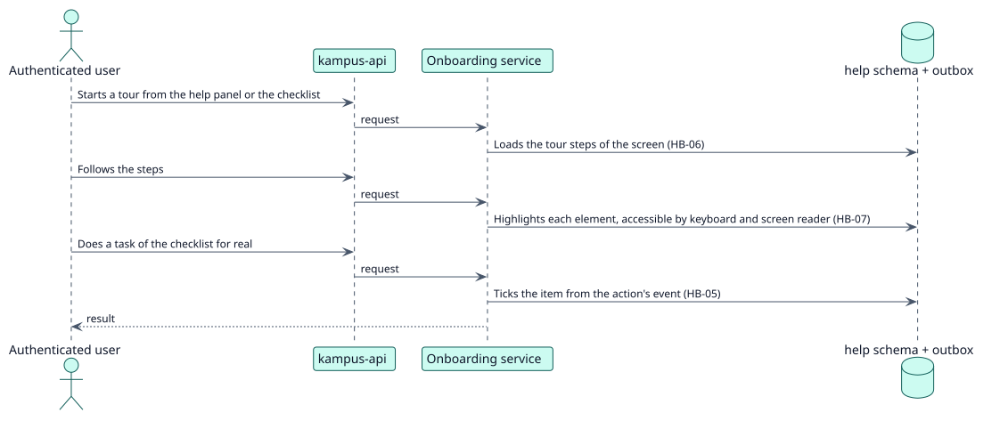

# UC-060 Take a guided tour or follow the onboarding checklist — design realization

| Overview | Requirements | Analysis | Design | Implementation | Tests |
| --- | --- | --- | --- | --- | --- |
| [Use cases](../../../01-requirements/use-case-overview.svg) | [Requirements](../../../01-requirements/use-cases/takeGuidedTour/README.md) | [Analysis](../../../02-analysis/use-cases/takeGuidedTour/README.md) | **Design** | [Implementation](../../../04-implementation/use-cases/takeGuidedTour/README.md) | [Tests](../../../04-implementation/use-cases/takeGuidedTour/README.md#tests) |

Analysis: [README](../../../02-analysis/use-cases/takeGuidedTour/README.md)

## Elements

| Design element | Kind | Code target |
| --- | --- | --- |
| Tour runner and checklist | UI | `web/src/shell/tours/` |
| Onboarding progress | service | `crates/users/src/service/onboarding.rs` |

## Sequence

## Data touched

| Table or entity | Operation |
| --- | --- |
| users.preference | update |
