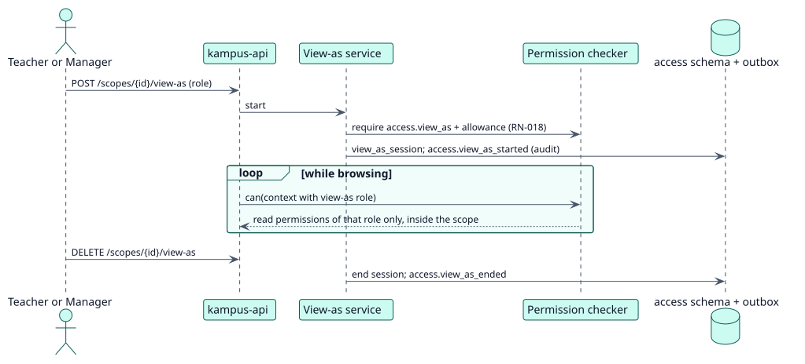

# UC-005 View a scope as another role — design realization

| Overview | Requirements | Analysis | Design | Implementation | Tests |
| --- | --- | --- | --- | --- | --- |
| [Use cases](../../../01-requirements/use-case-overview.svg) | [Requirements](../../../01-requirements/use-cases/viewAsRole/README.md) | [Analysis](../../../02-analysis/use-cases/viewAsRole/README.md) | **Design** | [Implementation](../../../04-implementation/use-cases/viewAsRole/README.md) | [Tests](../../../04-implementation/use-cases/viewAsRole/README.md#tests) |

Analysis: [README](../../../02-analysis/use-cases/viewAsRole/README.md)

## Elements

| Design element | Kind | Code target |
| --- | --- | --- |
| View-as service | service | `crates/kampus-access/src/view_as.rs` |
| `/api/v1/scopes/{scope_id}/view-as` | API endpoint | `docs/03-design/api/access.openapi.yaml` |
| `access.view_as_session` | table | `docs/03-design/data-model/access.md` |

## Sequence

## Data touched

| Table or entity | Operation |
| --- | --- |
| access.view_as_session | insert, update |
| events outbox | insert view-as events |
