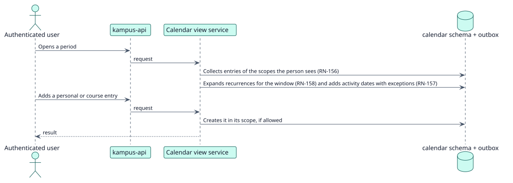

# UC-039 See the calendar — design realization

| Overview | Requirements | Analysis | Design | Implementation | Tests |
| --- | --- | --- | --- | --- | --- |
| [Use cases](../../../01-requirements/use-case-overview.svg) | [Requirements](../../../01-requirements/use-cases/viewCalendar/README.md) | [Analysis](../../../02-analysis/use-cases/viewCalendar/README.md) | **Design** | [Implementation](../../../04-implementation/use-cases/viewCalendar/README.md) | [Tests](../../../04-implementation/use-cases/viewCalendar/README.md#tests) |

Analysis: [README](../../../02-analysis/use-cases/viewCalendar/README.md)

## Elements

| Design element | Kind | Code target |
| --- | --- | --- |
| Calendar view service | service | `crates/kampus-calendar/src/view.rs` |
| `/api/v1/calendar` | API endpoints | `docs/03-design/api/calendar.openapi.yaml` |

## Sequence

## Data touched

| Table or entity | Operation |
| --- | --- |
| calendar.entry, calendar.entry_exception, calendar.activity_date | select |
