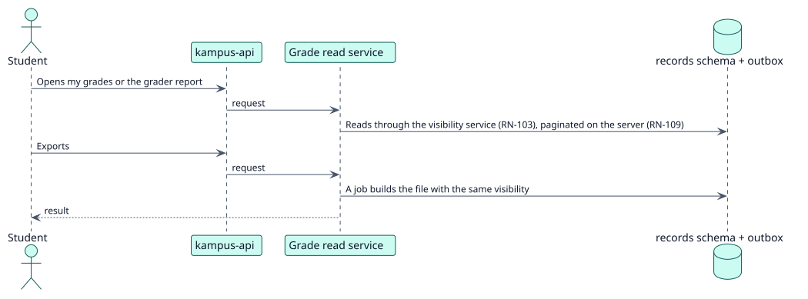

# UC-029 See grades — design realization

| Overview | Requirements | Analysis | Design | Implementation | Tests |
| --- | --- | --- | --- | --- | --- |
| [Use cases](../../../01-requirements/use-case-overview.svg) | [Requirements](../../../01-requirements/use-cases/viewGrades/README.md) | [Analysis](../../../02-analysis/use-cases/viewGrades/README.md) | **Design** | [Implementation](../../../04-implementation/use-cases/viewGrades/README.md) | [Tests](../../../04-implementation/use-cases/viewGrades/README.md#tests) |

Analysis: [README](../../../02-analysis/use-cases/viewGrades/README.md)

## Elements

| Design element | Kind | Code target |
| --- | --- | --- |
| Grade read service | service | `crates/kampus-records/src/read.rs` |
| `/my-grades`, `/grader-report`, export | API endpoints | `docs/03-design/api/records.openapi.yaml` |

## Sequence

## Data touched

| Table or entity | Operation |
| --- | --- |
| records.grade, records.record | read |
