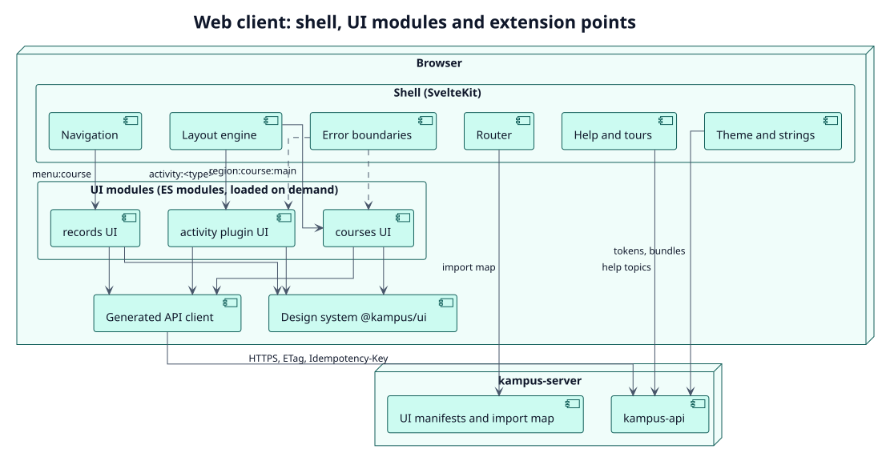
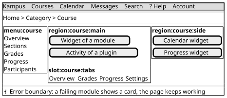

# Web client

The web client (`web/`) is a **Next.js** application in **React** and **TypeScript** (DEC-089). Its shell places the **UI modules** of every Kampus module and plugin into its **extension points** (DEC-004, DEC-074). It holds no business logic: everything comes from the API through a generated client (DEC-076). Its components come from `@kampus/ui`, a design system built on **MUI** and themed by Didactika's identity (DEC-013), which prevails over MUI's defaults. Requirement RF-008; RNF-003, RNF-010.



## Packages

The client is one npm workspace at the root of the repository (`package.json`), so the shell, the shared packages and the UI module of every Kampus module build and test together:

| Package | Folder | Holds |
| --- | --- | --- |
| `@kampus/web` | `web/` | The Next.js application: the shell and the registry of UI modules |
| `@kampus/ui` | `web/ui/` | The design system: tokens, the MUI theme, components, patterns and icons |
| `@kampus/sdk` | `web/sdk/` | The generated API client and the UI module contract |
| `@kampus/<module>-ui` | `crates/<module>/web/` | The UI module of a Kampus module, next to its Rust crate, as a plugin ships both in one package (RN-204) |

`npm run check`, `npm test` and `npm run build` at the root run every package; CI runs them in the job *Web client*. Everything is TypeScript in strict mode; tests live in `tests/` of each package, never next to the code.

## Folder structure

Every package keeps one layout, so a module or a plugin looks the same as the shell from inside, and a new one starts from the same skeleton. Folders hold one concern each; a component is a folder named like it, with an `index.ts` that is its only entry.

```text
web/                                   @kampus/web, the Next.js application
  next.config.ts
  src/
    app/                               routing files of the App Router only: layout, page, loading, error, not-found
      layout.tsx                       the document: language, direction, theme of the scope, providers
      (auth)/sign-in/page.tsx          pages without the frame of the campus
      (campus)/layout.tsx              the frame: app bar, navigation, the region of toasts
      (campus)/page.tsx                the dashboard
      (campus)/[...path]/page.tsx      the pages of UI modules, found in the registry
    features/<feature>/                the screens and parts of the shell itself (session, navigation, preferences)
    modules/                           the generated registry of UI modules and the extension points
    theme/                             the theme of the scope as an MUI theme, and the scheme of the person
    i18n/                              message bundles and formatters
    api/                               the API client set up for the server and for the browser
  tests/
    unit/
    e2e/                               Playwright, one file per use case
  ui/                                  @kampus/ui, the design system
    tokens/                            reference, system, light and dark tokens (W3C)
    src/
      theme/                           tokens and the roles of a scope turned into the MUI theme
      components/<Component>/          Didactika's components over MUI: <Component>.tsx and index.ts
      patterns/<Pattern>/              Didactika's patterns: list toolbar, filters, table, pager, selection bar, wizard, empty state
      icons/                           Material Symbols by name, the registry and its overrides
      tokens/                          reading the tokens, contrast
    tests/
  sdk/                                 @kampus/sdk, the generated API client and the UI module contract
crates/<module>/web/                   @kampus/<module>-ui, the UI module of a Kampus module or plugin
  kampus-ui.json                       the manifest: routes, contributions, strings, events
  src/
    index.ts                           the module: its routes and contributions, typed by @kampus/sdk
    routes/<route>/                    one folder per page of the module
    contributions/<point>/             widgets, menu items, tabs, actions, form sections, settings panels
    components/<Component>/            components private to the module
    strings/                           the message keys of the module, per language
  tests/
```

A module uses the components and patterns of `@kampus/ui`, or MUI directly with the theme; it never sets a colour, a font or a radius of its own, and never restyles a component of the design system.

## Shell



| Part | Responsibility |
| --- | --- |
| Router | The App Router of Next.js: the pages of the shell, and the routes UI modules declare (`/courses/:id`, `/admin/settings`…) through the registry; server-side rendering of the first page, client navigation afterwards |
| Layout engine | Renders the page kind's regions from the resolved layout (RN-216); a widget whose module is disabled or failing is skipped with a placeholder |
| Navigation | Menus from data (DEC-071), filtered by permissions |
| Session | Signed-in account, current scope, language and time zone; reacts to revocation (DEC-031) |
| Theme | Turns the theme of the scope of the page into the MUI theme, in light and dark; the scheme of the person; direction from the language (RN-192) |
| Strings | Loads message bundles per module and language (RN-191), with terms applied |
| Help | Opens the help topic of the current screen and runs guided tours (DEC-077) |
| Error boundary | One per extension point: a failing UI module shows an error card and reports it, the rest of the page works |

## UI module contract

A UI module is a React package with a `kampus-ui.json` manifest, written with `@kampus/ui`. Each Kampus module and each plugin ships at most one.

| Manifest section | Content |
| --- | --- |
| `module` | id (the module or plugin id), version, SDK range, entry file |
| `routes` | path, page kind, permission required to show it, help topic |
| `contributions` | widgets (for regions), menu items, page slots (tabs, panels, actions), form sections for other modules' forms, settings panels |
| `strings` | the message keys the module uses (checked against its declared messages) |
| `events` | client events it emits and listens to |

Rules:

| ID | Rule |
| --- | --- |
| UI-01 | UI modules are built into the client from a registry generated from the installed modules (`tools/repo-check --fix`); each page and contribution is loaded lazily, only when it is shown. |
| UI-02 | A contribution is shown only when its module is enabled in the scope (RN-209, RN-220) and the viewer holds its permission; the API remains the authority (DEC-017). |
| UI-03 | Extension points have typed props and events; a module never reaches into another module's DOM or state. |
| UI-04 | Every route and contribution declares a help topic (DEC-077); the build fails without it. |
| UI-05 | Every text is a message key (RN-187); every date, number and money value goes through the locale formatter (RN-192). |
| UI-06 | UI modules talk to the API only through the generated client; they never build URLs by hand. |

## Extension points

| Point | Where | Filled with |
| --- | --- | --- |
| `region:<page kind>:<region>` | regions of every page kind (for example `course:main`, `course:side`, `dashboard:top`) | widgets |
| `menu:<menu kind>` | primary navigation, course navigation, user menu, admin menu | menu items |
| `slot:<page kind>:tabs` | tabs of an entity page (course, activity, profile) | panels |
| `slot:<page kind>:actions` | action menus of entities | actions |
| `form:<form id>:sections` | forms of other modules (course settings, profile, enrolment method) | form sections with their own validation |
| `settings:<scope kind>` | settings pages | settings panels |
| `activity:<type>` | the view and editor of a course module | the activity type's pages (RN-075) |

## Design system

`@kampus/ui` is built on **MUI** and follows its Material Design components. It has **Didactika's identity** as its default theme (DEC-013) and Didactika's rules of meaning for each element; where they disagree with MUI's defaults, Didactika prevails.

| Aspect | Rule |
| --- | --- |
| Components | MUI components with Didactika's theme. Didactika's own components on top fix what each element means: `Button` (with `tonal`, tones and sizes), `ButtonGroup`, `TextField` (label above the field), `ConfirmDialog`, `Badge`, `Icon`, `Loading`, toasts, and later the date picker, the rich text editor and the file picker. Patterns come on top of those: the list toolbar, filters, the table, the pager, the selection bar, the wizard and the empty state |
| Theme | `createKampusTheme` turns the tokens and the colour roles of a scope into an MUI theme with CSS variables and both colour schemes. Didactika's look is in the theme's component styles, so MUI used directly looks the same |
| Tokens | W3C design tokens in four documents: the **reference** palettes (Didactika's teal, slate, cyan and the colours of state); the **system** tokens (typefaces, type scale, corners, density, sizes, spacing, elevation, motion); and the **colour roles** of the light and the dark scheme |
| Colour | Material roles: `primary`, `secondary`, `accent`, `danger`, `success`, `warning` and `info`, each with `on-`, `-container` and `on-…-container`; `brand`; surfaces from `surface-container-lowest` to `-highest`; `on-surface`, `on-surface-variant`, `outline`, `outline-variant`; inverse roles, `scrim` and `shadow`. They map to the MUI palette (`primary.main`, `primary.contrastText`, `error`, `background.default`, `text.secondary`, `divider`…), and the rest are added to it. The page follows the system unless the theme or the person chooses |
| Type | IBM Plex Sans for text, Space Grotesk for display, headlines and large titles; sizes in rem, so they follow the size of the theme |
| Shape | Corners from one radius: buttons are pills, fields and menus have small corners, cards medium ones and dialogs large ones. A radius of 0 makes every shape square |
| Density and motion | Comfortable or compact; reduced motion turns transitions off |
| Meaning | One meaning per element. A filled button is the main action of an area, and there is one per area; outlined buttons are ordinary actions and text buttons the least. `danger` removes or stops and always asks first; `success` starts a process. Badges are tinted with their state. The name of a row opens it. An action a row cannot take is disabled, never hidden |
| Patterns | A list has a toolbar: a search that applies as the person types, a Filters button with the number of filters on, and the actions of the page at its end. Its table has a fixed height, a sticky head and a pager under it (12, 24, 48, 96, and All up to 500 rows). A selection gets a floating bar. Wizards have a stepper. Dialogs say what stays. Empty states say why and what to do |
| Accessibility | WCAG 2.2 AA: keyboard operation, visible focus, roles and names, reduced motion honoured, forms with labelled errors, live regions for asynchronous results. The contrast of every role is checked in CI in both schemes, and axe checks the components in a browser |
| Internationalisation | Right-to-left through MUI's direction and logical CSS properties; every text comes from the caller, never from a component |
| Breakpoints | MUI's: `xs` from 0, `sm` 600, `md` 900, `lg` 1200, `xl` 1536; layouts from 320 px wide |

## Icons

Icons are [Material Symbols](https://fonts.google.com/icons) in the rounded style, by name (`<Icon name="delete" />`), drawn in the colour of the text. They live in a registry, where the design system and each UI module define the icons they use and ship them with their code. One meaning has one icon everywhere:

| Icon | Meaning |
| --- | --- |
| `delete` | Removes |
| `edit` | Changes |
| `visibility`, `visibility_off` | Shows or hides |
| `info` | Opens the details |
| `history` | Opens the versions |

A theme overrides any icon by name with the address of an image. The image is drawn as a mask in the colour of the text, so it follows the theme and runs nothing.

## Brand and icons per scope (later phase)

The design system is ready for these. The editors and the storage come in a later phase of the web client, through the customisation module, with the same inheritance and locks as themes (RN-213, RN-217).

| What | How it will work |
| --- | --- |
| Every colour | Beyond the seeds, an advanced mode sets any colour role of either scheme, checked for contrast like the grown ones |
| Logos and favicon | The logo for light and dark backgrounds, the compact mark, the favicon and the application icon (maskable). They are uploaded once, and the sizes a browser asks for are derived from them |
| Brand images | The image of the sign-in page, the default cover of a course and the header of mail |
| Icon set | The style of Material Symbols (rounded, outlined or sharp), whether icons are filled, and their weight |
| Own icons | Any icon replaced by an uploaded SVG or PNG (sanitised when stored), from an editor that lists every icon name with search, a preview and a way back to the default. Rules can scope an override to a page kind or a region, as the icon designer of the Didactika plugins does. Packages carry overrides to other scopes and campuses |

## Theming per scope

The look is configuration in every scope (RN-217): the platform, a tenant, a campus, a category or a course sets the tokens of its theme, and a scope below inherits them unless it sets its own or a scope above locks them.

| Step | What happens |
| --- | --- |
| Default | The tokens of `@kampus/ui` hold Didactika's theme in both schemes |
| A scope sets tokens | Seed colours, typefaces, size, radius, density, motion and preferred scheme; the server grows the roles of both schemes, keeping WCAG 2.2 AA contrast |
| The shell shows a page | On the server it reads the theme of the scope of the page (`GET /api/v1/customise/scopes/{scope}/theme`) and makes the MUI theme from its roles and tokens, so the first paint already has it; no code changes and nothing is rebuilt. `theme.css` serves the same roles as custom properties for pages outside the client, such as mail previews |
| The person chooses | Light, dark or the system, stored with the person and applied as `data-theme` on the root |

The default theme and the theme the server grows for the default tokens are the same; a test of the customisation module compares them.

## Data and state

| Concern | Rule |
| --- | --- |
| API client | Generated from the OpenAPI document (RN-195); typed requests and problem details (DEC-018) |
| Caching | Per resource, revalidated with ETag; changes send `If-Match` and show conflicts to the person (DEC-026) |
| Repeated actions | Mutations carry an `Idempotency-Key`, so a double click never creates twice |
| Live updates | WebSocket subscription to the events the viewer may see, for notifications, messages and activity states |
| Offline | Out of scope for the first release (RF-117) |

## Quality

Playwright end-to-end tests per use case, automated accessibility scans on every page (axe) plus a manual audit per release (RNF-003), visual regression of the design system, and bundle budgets per UI module. Wireframes of each use case are in its requirements card.
